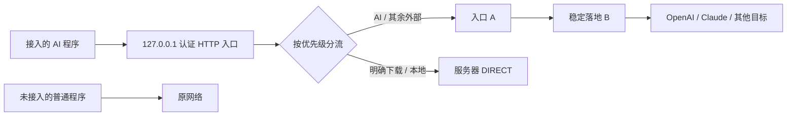

# Linux AI 两跳代理管理

给 Linux / SSH 终端使用的 mihomo 管理工具：方向键菜单、A→B 链式代理、AI/下载分流、实时流量观测。每位使用者填写自己的节点，无需修改源码；仓库只提供通用规则和无效示例地址。

**课题组同学第一次用：先看 [新手部署步骤](docs/quickstart.md)，再按 [代理配置填写位置说明](docs/node-configuration.md) 填自己的入口 A 和落地 B。**

| 你要做什么 | 文档 |
|---|---|
| 在新服务器/自己的账号上安装 | [新手部署步骤](docs/quickstart.md) |
| 填订阅、入口、美国静态/家宽落地 | [代理配置填写位置说明](docs/node-configuration.md) · [JSON 模板](templates/nodes.example.json) |
| 查看 GPT/Claude 代理规则、pip/torch/CUDA 直连规则 | [分流策略](docs/routing-policy.md) · [内置规则](rules/) |
| 验证可用性、处理 403 或链路失败 | [验收清单](docs/deployment-validation.md) · [排障](docs/troubleshooting.md) |
| 迁移、升级、日常操作 | [迁移与升级](docs/migration.md) · [速查表](docs/cheatsheet.md) |
| 分享配置、提交 Issue 或代码 | [隐私与分享](docs/privacy.md) |

普通用户的 Linux 中文终端应用。一个认证 HTTP 入口、一个 mihomo 用户服务；不启用 TUN，不修改路由、防火墙、系统 DNS、IPv6 或全局 shell 代理。只保护明确接入且实测过的应用，不控制忽略代理的进程、UDP 或其他账号。

## 安装

新机器首次安装：

```bash
git clone https://github.com/zrj-cn/ai-proxy-public.git
cd ai-proxy
./install.sh --check
./install.sh
~/.local/bin/ai-proxy
```

依赖：Linux amd64/arm64、Python ≥3.8、systemd 用户管理器、TLS 根证书、Git（克隆时）。导入 YAML 订阅还需 `python3-yaml`；Ubuntu 管理员可用 `apt install python3-yaml`，JSON 不需此包。工具不会执行不透明的远程脚本，也不会自动 sudo。首次固定安装官方 mihomo **v1.19.32**，同时验证官方 Release 的 SHA256。固定哈希见 `versions.json`；后续 `update vX.Y.Z` 要求官方 API 提供对应 SHA256，拒绝缺少校验的版本。SHA256 证明内容与官方发布一致，不等于独立签名审计。

安装可重复执行，保留端口、秘密、节点选择及自定义规则。`--check` 无写入。默认端口 HTTP `17890`、API `19090`，首次可用 `--port` / `--api-port`，安装前检查冲突。已有端口配置不会因重新安装被覆盖。重复安装不等于零中断升级：应用配置/重载可能关闭既有连接，已有实例请安排维护窗口，见 [迁移与升级](docs/migration.md)。

首次缺少真实 A/B 时服务仍可启动，但界面明确显示 **未配置**：AI 和其余外部请求 REJECT，只有明确 DIRECT 目标可用；不虚构链路。通过菜单添加节点后选择 A/B，或：

```bash
# 先在服务器安全准备 600 文件；不要在 shell 命令或聊天中输入密码
chmod 600 /安全路径/nodes.json
./install.sh --non-interactive --nodes-file /安全路径/nodes.json --entry my-A --exit my-B --configure-claude
ai-proxy app configure codex
ai-proxy doctor --network
```

节点文件结构见 [`templates/nodes.example.json`](templates/nodes.example.json)，逐字段填写说明见 [节点配置](docs/node-configuration.md)，示例域名不能运行。秘密文件在仓库以外准备，导入只接受当前账号拥有、权限无组/其他访问且非符号链接的文件。菜单密码/订阅 URL 隐藏输入。订阅支持 mihomo `proxies` YAML/JSON 或 base64 的简单 TCP URI 列表，直接 HTTPS 下载（8MB 上限），不使用在线转换器；只提取受支持节点，不导入订阅内的规则、认证、监听、脚本等。URI 订阅中显式跳过证书校验的设置会保留并输出数量提示；新手动节点默认验证，需明确选择才跳过。订阅含未支持协议会整批拒绝，需先导出支持的 TCP 节点；不会静默跳过。

## 方向键界面

运行 `ai-proxy` 即可使用完整中文菜单，不需要输入数字、英文操作名或节点 ID。

| 按键 | 操作 |
|---|---|
| ↑ / ↓ | 选择项目或滚动结果 |
| → / Enter | 进入菜单、选中节点或确认操作 |
| ← / Esc | 返回上级、取消编辑 |
| PgUp / PgDn | 长节点列表与结果翻页 |
| Home / End | 跳到首尾 |
| Ctrl+C | 退出界面并恢复终端；后台服务保持原状态 |

例如换入口：**↓ 选“切换入口 A” → Enter → ↑↓ 选择节点 → Enter**。列表直接显示订阅里的真实节点名称，当前 A/B 有标记，打开时默认选中当前节点；重新确认当前节点不会触发重载。切换 B 只列出支持的落地协议。

订阅更新、服务开关、检测 A/B、查看出口、配置应用和维护均由子菜单选择。新增节点使用逐字段表单，协议、TLS、证书验证、规则类型和路由动作也用方向键选择。已有文件通过目录浏览器选择，避免手输路径。只有新地址、域名、密码、订阅 URL 或其他明确版本等必要新内容才需要文字输入；已有值可直接保留，密码和 URL 始终隐藏。表单支持左右移动、退格、Delete、Ctrl+U 清空；Esc 取消，不提交草稿。保存失败可继续修改草稿。

使用 Python 标准库 curses，不增加 pip/TUI 平台依赖。需要交互 SSH 终端，推荐 TERM=xterm-256color，最小42列×10行；支持普通 CSI 和应用模式 SS3 方向键序列。非交互环境使用原 CLI，例如 `ai-proxy status`、`ai-proxy help`。CLI 的功能和命令保持可用，菜单与 CLI 共用保存和应用逻辑。

## 实时流量面板

主菜单选择 **实时流量 · 最终目标与通道**，或直接运行：

```bash
ai-proxy traffic
```

每秒刷新。顶部显示总上传/下载速率、核心累计、A→B业务汇总及流量趋势；列表默认按 Claude、OpenAI、GitHub、Hugging Face 等最终服务汇总，未知服务显示域名或 IP。回车查看具体最终域名。中转 A/B 地址不会作为访问目标铺满列表。

实际通道取核心连接记录，显示完整代理、直连、回退直连、仅A、拒绝或待识别；不按规则预测冒充实际结果。同一服务走不同通道时分行，便于发现异常直连。观测台采用深色卡片、薄荷绿完整代理、金色直连、粉色回退/未知，选中行高亮；无颜色时保留文字。

| 按键 | 操作 |
|---|---|
| ↑ / ↓ | 选择目标，自动翻页；无需 PgUp/PgDn |
| ← / → / 1–5 | 切换通道筛选 |
| Tab / F1–F3 | 切换总览、目标、趋势视图（无需功能键也可用） |
| Enter / D | 查看或返回目标详情 |
| 空格 | 暂停/继续画面，后台仍采样 |
| F | 仅活跃 / 同时显示近期30秒结束的连接 |
| S | 按速率、本页流量、目标名称排序 |
| / | 搜索域名或服务；清空回车恢复全部 |
| ? | 查看统计口径与操作帮助 |
| Esc / Q | 返回菜单；独立启动时退出面板 |

面板最小60列×16行；100列×24行起显示分区观测台，建议140列×40行以上。总览含三张大号速率卡片、业务流量趋势、目标下载速率排行和连接列表；Tab切换完整目标列表或趋势视图。较矮窗口收起图表/大号数字，窄终端保留目标、通道和下载速率，更多信息在详情。支持窗口缩放、Ctrl+C恢复终端、`NO_COLOR=1`。

统计口径：顶部总速率/核心累计取 `/connections` 全局计数，包含已结束连接；列表及A/B汇总按每秒连接快照计算本页观测到的业务字节，进入页面时已有连接从首次快照作基线。短连接、关闭前的最后字节可能漏采，因此分项之和可能小于全局流量。A/B承载同一份完整链路业务量，不重复相加；这里没有独立测量网卡、TLS/SOCKS封装或供应商计费流量。核心计数下降时自动重置本页统计。趋势保留最近60次采样，断开期间留空，不伪装成流量为零；没有采样前显示等待，不填充历史数据。

只观察接入本工具的连接，不监听全机网络，不读取请求内容、Cookie或账号文件，不保存访问历史。所有样本只在内存保留，退出即清除；服务停止或控制API不可达时保留旧数据、速率显示“—”、标注过期并自动重连，不改变服务和路由。**数据读取正常/有连接/有字节都不证明HTTP成功或AI已回复；尚未建连的失败请求和极短连接可能不出现在列表。**

## 快速开关与清晰输出

```bash
ai-proxy on       # 开启用户代理服务
ai-proxy off      # 停止服务，保留应用代理设置
ai-proxy toggle   # 在开与关之间切换
ai-proxy restart  # 重启服务
ai-proxy status   # 中文状态摘要
```

这些命令不修改父 shell 的环境变量或全局网络。停止后已接入应用暂时不可用，包含原本 DIRECT 的下载；普通未接入程序沿用原网络。`on`/`off`不会自动移除应用设置导致AI直连。

测试、诊断和规则默认输出中文摘要，不再铺满JSON。绿色表示通过/直连，紫色表示完整代理，黄色表示回退或未核实，红色表示失败。当前选中项目用蓝底高亮；颜色之外保留文字含义。支持 `NO_COLOR=1` 和无颜色终端。

菜单结果页按 **D** 展开/收起中文技术详情，长行自动换行，↑↓即可滚动，不需要PgUp/PgDn。CLI需要更多细节时用 `ai-proxy --details doctor`；脚本获取结构化数据请显式 `ai-proxy --json doctor`，也支持 `ai-proxy doctor --json`。`ai-proxy run -- codex --json ...` 的子命令参数仍原样传递。

pip/PyPI、PyTorch CPU/CUDA wheel和NVIDIA CUDA/cuDNN/驱动下载默认直连，包含PyPI文件CDN和PyTorch的download-r2文件源，无需启用可选开发规则；实时面板分别显示PyPI / pip、PyTorch、NVIDIA / CUDA。

规则首页改为“始终代理 / 始终直连 / 代理优先可回退”三类，详见 [策略、回退边界与 Claude 域名](docs/routing-policy.md)。AI始终完整A→B，只有你显式指定的其他域名允许回退。已有规则不自动改成可回退。

## 网络路径与范围



实际配置把 `dialer-proxy: ENTRY_A` **放在 EXIT_B 节点上**，规则选择 EXIT_B；核心先与 A 建立连接，经 A 连接 B，再由 B 访问目标。不是把两个节点放在一个 select 组，AI 与始终代理路径不使用 relay/fallback/url-test，任意一跳失败都没有 DIRECT/A 单跳/直连 B 回退。只有显式指定的非 AI 可回退规则另用健康检查组。`test B` 是明确的、隔离的 B 单独诊断，会直接拨号 B；生产 AI 流量始终选择完整链。

支持入口：HTTP、SOCKS5、SS、VMess、Trojan、VLESS 的简单 TCP 节点；落地：HTTP、SOCKS5、SS、VMess 的 TCP 节点。TLS 默认验证证书；订阅显式 `allowInsecure=1` 或节点显式 `skip-cert-verify: true` 会按输入保留，节点列表和总览标出风险。这类节点无法验证该代理跳的身份，可能遭中间人攻击；目标 HTTPS 证书验证不因此关闭。当前工具拒绝 QUIC/Hy2/TUIC/WireGuard、Reality、ShadowTLS、WS/gRPC 和未知字段，不默认所有协议可串联。**UDP 不支持**，不开放 SOCKS/mixed/UDP 入口。B 协议不支持时拒绝生成；节点修改仍需 `test` 实测。

DNS：禁用 mihomo DNS 监听，沿用系统解析器。入口 A 的主机名由服务器系统解析，B/目标的解析位置依赖协议及 mihomo 拨号实现：HTTP CONNECT 和 SOCKS5 可向上游传递域名，SS/VMess 也可传递目标域名；不承诺 DNS 全程经代理、不覆盖系统 UDP/DNS。没有使用代理自身作为 DNS 上游，因此不形成自依赖循环。IP 规则带 `no-resolve`，只匹配请求已提供的 IP，域名解析出的私网 IP 不会使域名 AI 强制规则降级为 DIRECT。

## 分流维护

优先级固定：内置 AI CHAIN → 自定义 CHAIN → 本地规则 → 自定义 DIRECT → 自定义可回退 → 内置 GitHub/HF DIRECT → 可选开发 DIRECT → MATCH CHAIN。CHAIN 与可回退规则在缺少 A/B 时均映射为 REJECT。禁止新增覆盖强制 AI 范围的 DIRECT；历史规则重叠由 `rule conflicts` 展示先命中者。`rule list` 显示优先级、来源；自定义规则用 `rule custom` 的编号编辑/删除。

GitHub 下载覆盖 raw/objects/release-assets/LFS 所在的 `githubusercontent.com`，特定旧 S3 主机单独列出。HF 覆盖 `huggingface.co`、`hf.co`，含其 Xet 的 cas-server、cas-bridge、transfer 子域及历史 LFS。**不匹配整个 amazonaws.com、Cloudflare 或共享 CDN IP 段。**新下载链路的重定向若超出现有范围默认走链路，需用 `probe`/`doctor --network` 检查再添加精确域名；若仍为未知下载域名，不宣称其直连。开启可选开发规则前检查流量目的。

AI 包含 OpenAI/ChatGPT 的 API、认证、静态和附件域名，以及 Anthropic/Claude API、认证、MCP、附件和 Desktop widget 域名。仅采用 Claude 官方确认的两个 Datadog 主机，不使用 `sentry`/`sift`/`datadog` 宽泛关键词。新增 clau.de、claudemcpclient.com 等 Claude 专用域名，逐项证据及保留的未知项见 [三类分流与 Claude 核对](docs/routing-policy.md)。任意新外部 AI/MCP 域名仍由默认 CHAIN 覆盖；显式列入下载域名的第三方 MCP 仍可能 DIRECT，需针对实际 MCP 端点加精确 CHAIN。规则无法保证账户不触发风控。

## 应用与停止语义

`app configure claude` / `claude-desktop` 仅合并本账号服务器 `~/.claude/settings.json` 的 env，保留其他设置，写入 600 文件；首次原文件留在私有备份。大/小写 HTTP/HTTPS/ALL/WS 代理变量一致，NO_PROXY 仅 `localhost,127.0.0.1,::1`。不修改登录文件，不在参数中传凭证，不修改 .bashrc。

Claude Desktop 的 SSH 引擎使用服务器设置，客户端不必一直在线以维持 mihomo；但 Desktop 任务本身是否继续由应用决定。现有进程环境可能优先于 settings，`app check` 仅显示冲突变量名和本账号进程是否继承新配置。实际 Desktop SSH 会话须重连并验证，工具不会终止现有 helper。当前不存在 Claude 也可预置设置，**不表示已安装或验证 Claude**。

Codex 检测实际 `--version` 后生成 `~/.local/bin/codex-ai`，以 `ai-proxy run codex` 注入进程环境，不改 `.codex/config.toml`、认证、provider 或当前 app-server。官方配置页中的 model provider/LLM gateway 与网络代理不是一回事；没有把网络代理填成模型 base_url。当前安装版本的 HTTP/WebSocket 环境行为必须经 `app-test codex` 验证，未验证的版本不宣称已接入。已有 Desktop Codex 进程不因安装工具而被重新配置。

```bash
ai-proxy run -- codex exec --skip-git-repo-check '只回复 OK'
ai-proxy run -- curl --max-time 20 https://huggingface.co/robots.txt
```

`run` 只改变新子进程环境，不污染父 shell，也不能更改已运行的其他应用。代理服务无效或 A/B 缺失时拒绝启动子进程。

**停止代理 = 停止用户服务，保留应用设置。**已接入应用的 AI 请求失败，连原本 DIRECT 的下载也可能失败；未接入的普通程序维持原网络。退出菜单、Ctrl+C 不会停止用户服务。不自动取消应用设置以恢复直连。环境中的认证是客户端工作所需，在本账号环境中存在；其他普通账号受 Linux /proc、权限和入口认证隔离，root/同账号进程不在保密边界内。

## 常驻、安全、验证

用户服务使用 `Restart=on-failure` 和 `WantedBy=default.target`。`loginctl show-user "$USER" -p Linger` 须为 yes 才具备退出登录/开机启动的必要条件；若当前无权设置，请管理员仅执行：

```bash
loginctl enable-linger 用户名
```

这不改整机网络。工具不自动重启共享服务器，不把 `systemctl enable` 推断为重启实测。不支持 systemd 的机器明确报错；使用已有用户 supervisor 的兼容条件见排障文档，tmux 不是可靠重启恢复。

所有代理请求必须认证；无回环免认证项。控制 API 独立随机密钥，仅 127.0.0.1。无 Web 面板。配置/数据/状态目录 700，节点、密钥、运行配置和备份 600。核心原始日志关闭以减少泄露，`service logs` 提供脱敏生命周期和应用事件。可用连接观测诊断路由，不输出代理用户名/密码、订阅 URL、节点地址或应用返回正文。

`doctor` 每项标注通过/失败/未验证；`--network` 对真实 GET 和重定向限制每跳最多读取 1024 字节、15 秒超时、最多 6 次跳转，不下载大模型。Range 被服务忽略时也只读有限响应后关闭，TCP 缓冲可能额外接收少量字节，不能保证线缆流量恰好 1KB。API `/connections` 采样提供命中规则及 chains；连接过快采不到则显示未验证，不能仅凭本地 remote_ip 或静态路由宣布通过。该 mihomo 版本的 chains 可能只列 EXIT_B，不列 dialer A；工具同时采样该核心 PID 的出站 socket，记录是否连接 A/直接连接 B，再结合断路和 B 独立出口对照。`exit-ip` 的临时实例强制 MATCH EXIT_B，查询不会默认 DIRECT。完整两跳证明还需 A/B 断路负向测试，只有 B 出口 IP 不够。

`tests/integration.py` 使用本机自建 A/B HTTP 隧道，检查 A 实际收到 B 的拨号、B 实际收到目标拨号、两个断路均无回退；这是**真实 mihomo 的本机机制测试**，不等同于真实运营商节点验收。`negative-test` 在隔离临时实例修改真实链路的坏节点，不动生产服务。`app-test` 使用应用自己的既有登录，发送一次最小请求（可能产生少量费用），不读取/复制登录文件；失败/未观测完整链时不宣布应用可用。`app-test --negative` 使用记录认证尝试但明确返回不可用的临时 HTTP 代理，对照此前相同节点配置的成功请求，观察非零退出、无回复、以及该进程树是否出现外部 TCP socket（20ms 采样）。超时或缺少证据标记未验证；通过仅限该次最小请求，不是网络层强制控制。诊断签名随节点/规则/入口改变失效，不沿用旧链路的应用通过结论。应用验证应在自己的维护窗口按需进行。

## 文件、恢复与迁移

| 内容 | 默认位置 | 是否进入 GitHub |
|---|---|---|
| 可审查源代码/内置规则/模板/文档 | 克隆仓库 | 是 |
| 程序副本、核心及 SHA256 receipt | `~/.local/share/ai-proxy/` | 否 |
| 节点/订阅 URL/随机代理和 API 密钥/自定义规则/机器端口 | `~/.config/ai-proxy/` | 否 |
| 含秘密的运行配置、上一份输入、脱敏诊断/事件 | `~/.local/state/ai-proxy/` | 否 |
| 受限本机快照与原 Claude 设置 | `~/.local/state/ai-proxy/backups/` | 否 |
| 服务单元 | `~/.config/systemd/user/ai-proxy.service` | 否 |
| 服务生命周期日志 | 用户 journal（核心日志关闭） | 否 |

`rollback config` 恢复上一份节点/规则/选择并验证重载；`rollback version` 校验后切回上个核心。运行配置从输入生成，不应手改。事务先验证，再应用；失败回写旧运行配置与输入，必要时重启恢复。更改已接入应用的端口会被拒绝，需维护窗口单独处理，避免持久设置失联。

`backup export` 只包含自定义规则、可选开发包开关，排除秘密、节点地址/名称、端口和机器路径；`backup import` 安全读取唯一成员，不解包任意路径。自定义规则中的域名仍可能含业务信息，分享前请审查。秘密迁移不提供自动导出/上传；在新机器用安全文件或隐藏输入补齐。新机器获取源码与配置见 [迁移](docs/migration.md)，故障与限制见 [排障](docs/troubleshooting.md)，日常命令见 [速查表](docs/cheatsheet.md)。

`uninstall --yes` 停止并移除本项目用户服务和命令入口，保留秘密/备份/核心与应用设置；不会意外使 AI 改为 DIRECT。彻底清理及有意退出代理的应用恢复步骤见排障文档。

## 官方依据

- [mihomo dialer-proxy 与协议限制](https://wiki.metacubex.one/config/proxies/dialer-proxy/)
- [mihomo 认证/监听/控制设置](https://wiki.metacubex.one/config/general/)
- [Claude 网络与具体服务域名](https://code.claude.com/docs/en/network-config)
- [Claude Desktop SSH 设置及环境优先级](https://code.claude.com/docs/en/desktop#ssh-sessions)
- [Codex 当前官方配置说明](https://developers.openai.com/codex/config-advanced)
- [Hugging Face Xet](https://huggingface.co/docs/hub/xet/index)
- [GitHub 域名允许清单](https://docs.github.com/en/copilot/reference/copilot-allowlist-reference)

第三方 Claude 域名线索页已查阅，但未采用其中时区/NTP/IPv6/宽泛遥测推论。规则来源与新机器验收分开记录，详见 [新机器验收清单](docs/deployment-validation.md)。


## 许可证

本项目源码以 [MIT License](LICENSE) 发布。mihomo 核心由安装器从上游下载，其许可证和第三方组件许可按各自上游执行。
